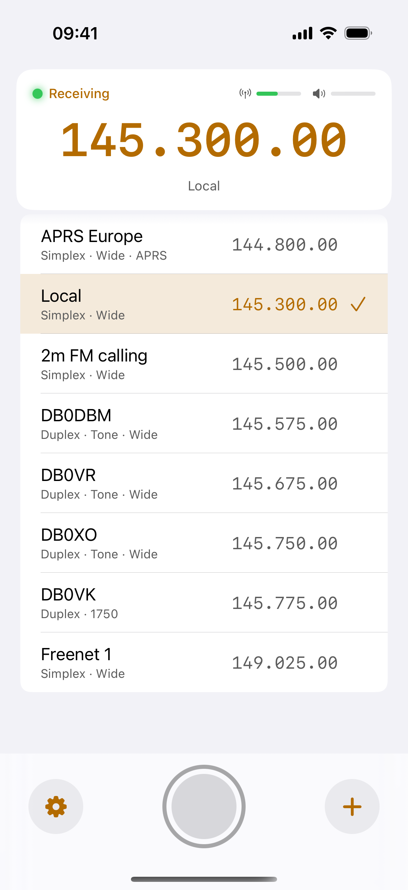
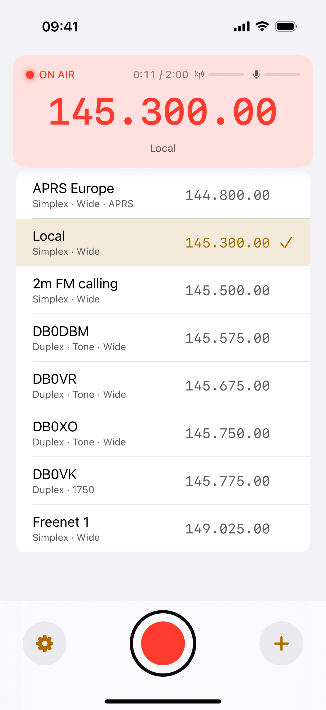
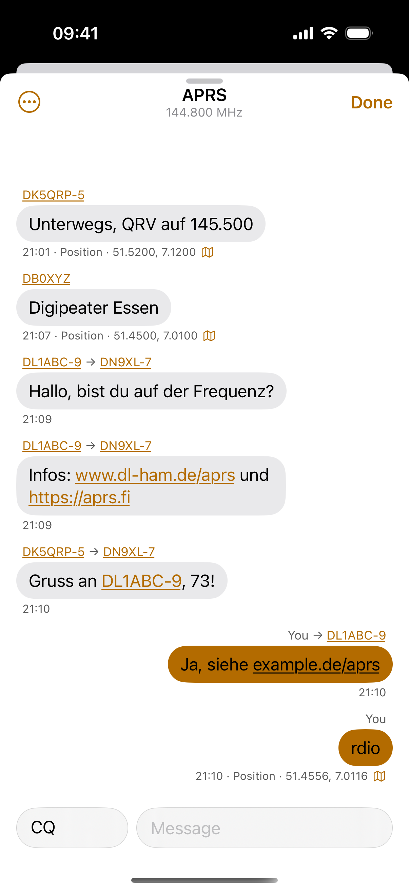
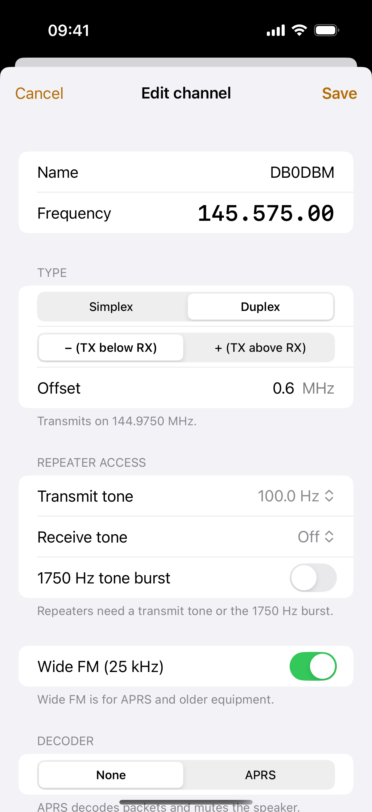
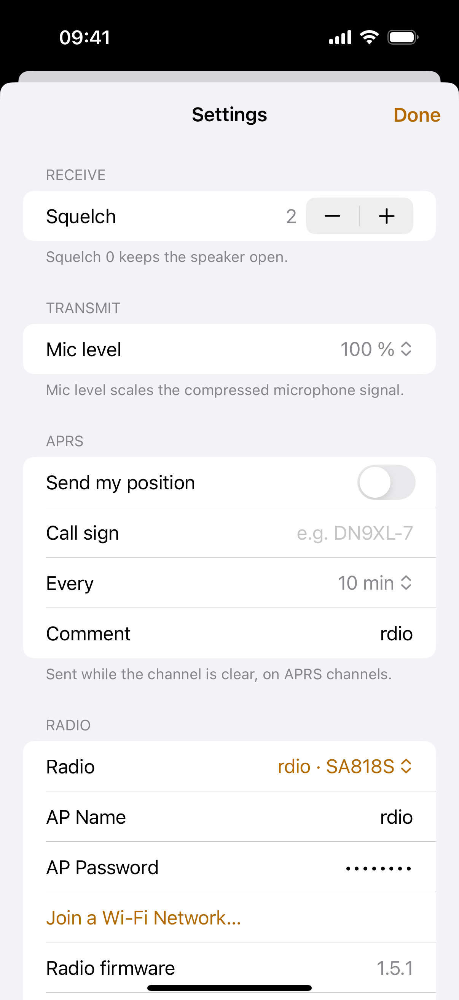
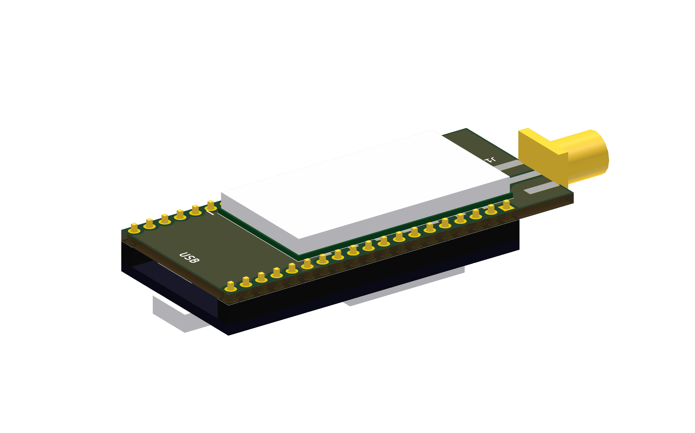
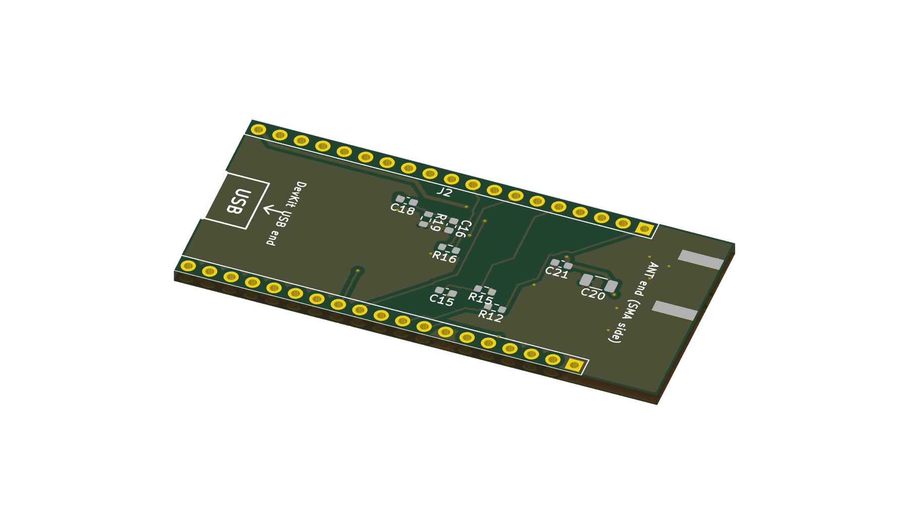
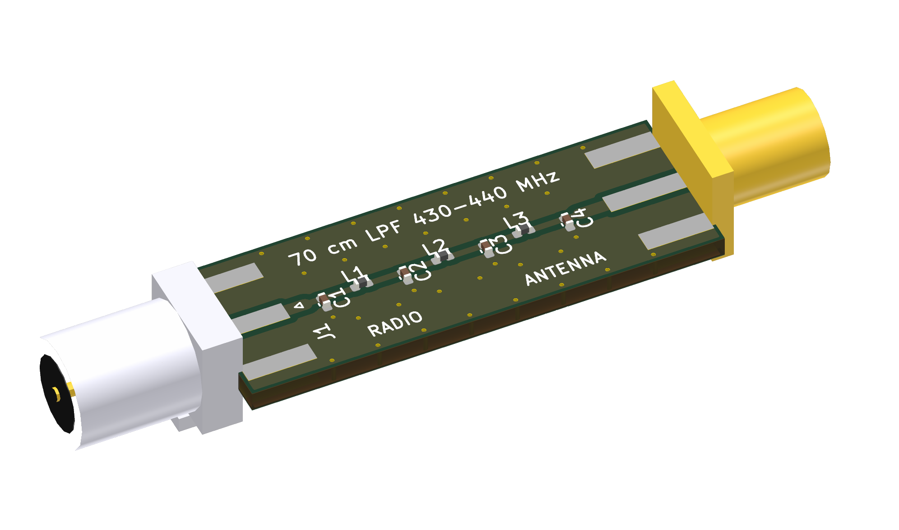

# rdio

A VHF/UHF radio you control from your iPhone. An ESP32 drives a DRA818 / SA818 transceiver module and streams the audio over Wi-Fi to a native iOS app: listen, push-to-talk, keep a list of channels and repeaters, and read APRS packets in a chat view.

<table>
  <tr>
    <td align="center"></td>
    <td align="center"></td>
    <td align="center"></td>
    <td align="center"></td>
    <td align="center"></td>
  </tr>
  <tr>
    <td align="center">Main screen</td>
    <td align="center">Transmit</td>
    <td align="center">APRS chat</td>
    <td align="center">Channel editor</td>
    <td align="center">Settings</td>
  </tr>
</table>

## How it works

- The ESP32 opens its own Wi-Fi network (or joins one you configure). The phone connects to it and talks to the radio over a WebSocket. Radios on a shared network are found automatically (Bonjour), so one app can control several of them.
- Receive audio goes from the radio to the phone as 16 kHz mono PCM. Transmit audio goes the other way while you hold the push-to-talk button.
- The module is tuned, squelched and keyed by the ESP32 through its UART, PTT and power-down lines.
- Bluetooth is not used.

## Features

- **Receive and transmit** in the selected band (VHF 134–174 MHz or UHF 400–480 MHz).
- **Channel list** with simplex and duplex (repeater) entries, shift direction and offset, CTCSS transmit and receive tones, and a 1750 Hz tone burst. Reorder by dragging, swipe to edit or delete.
- **APRS** on 1200 baud AFSK: the app decodes received packets (positions, Mic-E, messages, status) on APRS channels, shows them as a chat with distance and a link to Maps, links call signs to QRZ.com. You can also send: type a message in the chat to a call sign or to CQ. Messages to a station are repeated until it acknowledges them, the app acknowledges messages addressed to you, and everything is sent only while the channel is clear. A periodic position beacon is available too.
- **Several radios:** each radio announces itself on the network as a Bonjour service (`_rdio._tcp`, with its name, module type and firmware version). The app lists the radios it finds in Settings → Radio and switches between them with one tap. Give every radio its own name (Settings → Radio Name), because the name is also its Wi-Fi and host name.
- **Phone microphone chain** with a compressor and a mic level setting, soft limiter on the radio side.
- **Native iOS design**: system controls, Light and Dark Mode, Dynamic Type, VoiceOver, haptics, no navigation bar.
- **Transmit safety**: the app only transmits inside the selected band, and the firmware releases the push-to-talk line when the connection drops, when no audio arrives, and after 120 seconds. Only one client can transmit.
- Firmware updates over Wi-Fi.

## Status

Working on a real radio: receive, transmit, channel handling, tones, tone burst, APRS decoding, and the APRS position beacon (tested over the air).

Not done yet: a scan function and a TX power switch (the carrier board wires the module's high/low power pin, but the firmware does not use it yet).

The carrier board and the harmonic filters below are **designed but not built or measured yet**. The filters are simulated only; check them with a NanoVNA before relying on them.

## Hardware

Everything is KiCad 10 and is generated by scripts, so the boards can be rebuilt and changed in code.

### Carrier board

A 57.3 × 25.4 mm two-layer board for an ESP32 38-pin DevKit (NodeMCU-32S style) and a DRA818 / SA818 module. The DevKit's own pins are soldered into the board from below, the radio module sits on the top side, and an SMA jack on the end opposite the DevKit's USB port carries the antenna signal on a short track.

<table>
  <tr>
    <td align="center"></td>
    <td align="center"></td>
  </tr>
  <tr>
    <td align="center">Top: radio module, DevKit below, SMA jack</td>
    <td align="center">Bottom: audio and supply parts, DevKit pin rows</td>
  </tr>
</table>

| Function | ESP32 pin |
|---|---|
| Module UART (RX / TX) | GPIO16 / GPIO17 |
| Power down (high = on) | GPIO19 |
| PTT (low = transmit) | GPIO18 |
| Squelch in | GPIO32 |
| RX audio in (ADC) | GPIO34, biased to 1.75 V by GPIO26 |
| TX audio out | GPIO25 |
| High / low power | GPIO23 (floating = 1 W, low = 0.5 W; not used by the firmware yet) |

- The module's supply pin is fed straight from the DevKit's 5 V pin, with a 47 µF and a 100 nF capacitor next to the module. The module's datasheet allows 3.3 to 4.5 V, so check the voltage on your DevKit's 5 V pin (many boards drop it through a diode from USB) before the first power-up.
- Pin numbers, the module name and the antenna end are printed on the top silkscreen inside the module outline, to help with placing it.
- Test status: the module's footprint and the DevKit's pin spacing were checked against real parts; the audio values are first-pass.

### Harmonic filters (2 m and 70 cm)

Two small all-SMD low-pass filters (7th-order Chebyshev, 0.1 dB ripple, 50 Ω) that go between the board's SMA jack and the antenna and cut the radio module's harmonics. Details, simulation and parts notes: [hardware/filter/README.md](hardware/filter/README.md).

<table>
  <tr>
    <td align="center"></td>
    <td align="center"></td>
  </tr>
  <tr>
    <td align="center">2 m, 144–146 MHz</td>
    <td align="center">70 cm, 430–440 MHz</td>
  </tr>
</table>

| | 2 m | 70 cm |
|---|---|---|
| Passband | 144–146 MHz | 430–440 MHz |
| Insertion loss (simulated) | 0.56 dB | 0.50 dB |
| 2nd harmonic (simulated) | 52 dB down | 63 dB down |
| Board size | 38.0 × 12.4 mm | 34.4 × 12.4 mm |

### Ordering the boards

Gerber, drill, bill of materials and placement files for JLCPCB are in [hardware/jlcpcb/](hardware/jlcpcb/): `radio/` for the carrier board and `filters/vhf`, `filters/uhf` for the filters. Check the LCSC part numbers in the bills of materials against JLCPCB's parts library before you order. The SMA connectors, the DevKit headers and the radio module are soldered by hand.

## Legal

Transmitting needs an amateur radio licence and must follow the rules that apply to you. The app limits the transmit frequency to the selected band, but you are responsible for staying within your licence and the local regulations.

**Privacy:** the app has no accounts, analytics or tracking. See the [privacy policy](https://loopmasta.github.io/rdio/privacy/).

## Repository contents

This repository lets a small group of testers order the hardware, build it, flash the firmware and install the app, with no software knowledge or development tools. It holds the hardware design (`hardware/`), the screenshots (`docs/`) and this description.

The software is not included and does not need to be built:

- **iOS app:** coming soon to the App Store.
- **Firmware:** installed from your browser with the [web flasher](https://loopmasta.github.io/rdio/flash/). Connect the ESP32 over USB, open the page in Chrome or Edge on a computer and press install.

The app will be linked here once it is available. The software might become open source at some point.
