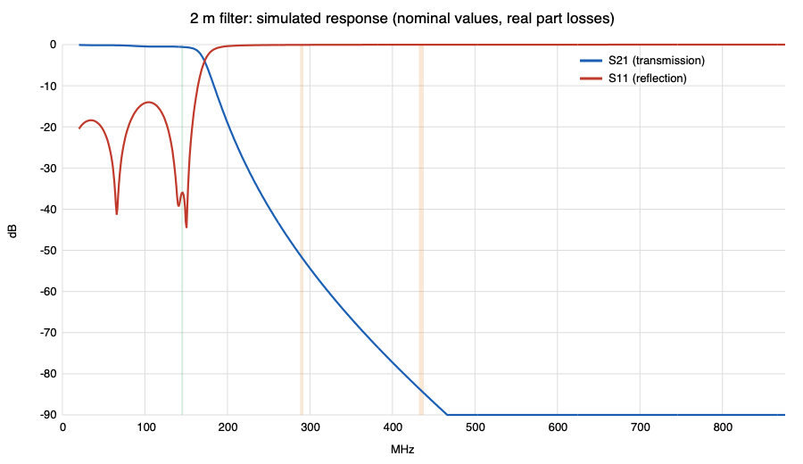
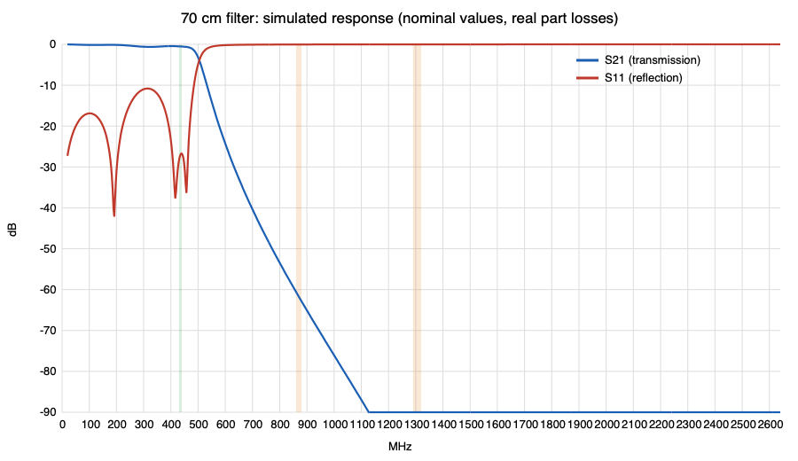

# Harmonic filters for the radio (2 m and 70 cm)

Two small all-SMD low-pass filters. Each goes between the carrier board's SMA connector and the antenna and cuts the
radio module's harmonics (the second harmonic is the one that matters). 7th-order Chebyshev (0.1 dB ripple), 50 ohm,
shunt-C first: C1 - L1 - C2 - L2 - C3 - L3 - C4. SMA in on one end, SMA out on the other, solid ground on both layers.

| | 2 m (`vhf/`) | 70 cm (`uhf/`) |
|---|---|---|
| Passband | 144-146 MHz | 430-440 MHz |
| Filter edge (0.1 dB) | 155 MHz | 460 MHz |
| C1 = C4 | 22 pF | 8.2 pF |
| L1 = L3 | 68 nH | 22 nH |
| C2 = C3 | 39 pF | 13 pF |
| L2 | 82 nH | 27 nH |
| Capacitors | C0G/NP0, 0402, 50 V | C0G/NP0, 0402, 50 V |
| Inductors | high-Q chip, 0603 | high-Q chip, 0402 |
| Board size | 38.6 x 12.4 mm | 35.0 x 12.4 mm |
| Insertion loss (simulated) | 0.56 dB | 0.50 dB |
| Return loss in band (simulated) | 36 dB | 27 dB |
| 2nd harmonic (simulated) | 52 dB down | 63 dB down |
| Worst case, 5 % parts, 500 runs | 0.77 dB loss, 50 dB at 2nd harmonic | 0.75 dB loss, 60 dB at 2nd harmonic |

Simulated response of the two filters:

<table>
  <tr>
    <td align="center"></td>
    <td align="center"></td>
  </tr>
  <tr>
    <td align="center">2 m, 144–146 MHz</td>
    <td align="center">70 cm, 430–440 MHz</td>
  </tr>
</table>

## What is simulated and what is not

The simulation (`tools/filter_sim.py`, see below how to run it) includes inductor Q (70 / 90), the inductors' winding capacitance, capacitor ESL and
ESR, and component tolerance. It does not include the board: pad and via parasitics, coupling between neighbouring parts,
and the SMA transitions. The board is a straight 50-ohm line with the shunt capacitors going to ground vias right at their
pads, but it has not been measured. Expect a few percent shift in the filter edge. Measure S21 and S11 with a NanoVNA
before relying on it, and trim a capacitor by one step if the passband edge is off. The very high simulated attenuation at
the 3rd and 5th harmonics (85 dB and more) is not realistic on a real board; coupling limits it to roughly 60-70 dB.
This is a design aid, not a compliance measurement.

## Running the simulation

`tools/filter_sim.py` computes the ideal values, picks the E24 values, simulates the response with the part losses and runs the tolerance test. It needs numpy, which is not installed by default (`pip install --target /tmp/np numpy`). From the repository root:

    PYTHONPATH=/tmp/np python3 hardware/filter/tools/filter_sim.py

It prints the results shown above and rewrites `design.json` and the `*-response.svg` plots in `vhf/` and `uhf/` (the PNG versions are converted from the SVG files separately). Inductor Q, capacitor losses and the parasitics are set at the top of the script (`BANDS`).

## Rebuilding the schematics and the boards

The schematics, the connector footprints and 3D bodies, and the boards are generated, so a change in `design.json` (or in a layout number) can be carried through. From the repository root, with KiCad 10 installed:

    python3 -I hardware/filter/tools/gen_filter.py          # schematics, footprints, 3D bodies (reads design.json)
    for b in vhf uhf; do
      kicad-cli sch export netlist --format kicadxml -o hardware/filter/$b/rdio-filter-$b.net.xml hardware/filter/$b/rdio-filter-$b.kicad_sch
      /Applications/KiCad/KiCad.app/Contents/Frameworks/Python.framework/Versions/Current/bin/python3 hardware/filter/tools/gen_filter_pcb.py $b
    done
    python3 -I hardware/jlcpcb/gen_jlcpcb.py vhf uhf        # order files

`tools/sch_engine.py` is the schematic writer behind `gen_filter.py`. `gen_filter_pcb.py` lays the board out along a straight 50 Ω line: the connectors at the two ends, the series inductors in the line, each shunt capacitor with a ground via at its pad, ground pours on both layers and stitching vias. Both scripts honour `FILTER_DIR` to write somewhere else than `hardware/filter`. Regenerating the boards gives the same parts and positions as the files in this folder (checked against the committed boards: same positions, tracks and zones, and no DRC violations); the schematics get new UUIDs.

## Parts notes

- LCSC part numbers for the capacitors and inductors, the two parts that are still open, and what the inductor Q costs: [../jlcpcb/README.md](../jlcpcb/README.md).
- Check that the inductor values exist in the series you pick (for example Coilcraft 0603HP or Murata LQW18 for 68/82 nH,
  Coilcraft 0402HP or Murata LQW15 for 22/27 nH) and that the Q is at least 50 at the band.
- 0402 parts are small to hand-solder. The 0603 inductors on the 2 m board are easier.
- The shunt capacitors see about 7 V peak at 1 W; 50 V C0G is plenty.
- Connectors: `J1` (marked RADIO) is an SMA **male plug**, the threaded kind with a coupling nut, so it screws straight onto
  the carrier's SMA jack with no adapter. `J2` (marked ANTENNA) is the **TE/Linx CONSMA020.062-G** SMA jack (female, edge mount,
  for 0.062 in = 1.57 mm boards, 50 ohm, to 18 GHz). Its footprint (`rdio-filter.pretty/CONSMA020_062_G`) is built from the
  Linx drawing's "recommended footprint": RF pad 1.5 x 5.6 mm, four ground pads 1.6 x 4.9 mm at 4.26 mm (two on each layer),
  recessed 0.25 mm from the board edge to keep the copper-to-edge clearance. The 6.5 mm "mounting hole" in that drawing is a
  panel cut-out, not a PCB hole. The 3D bodies of both connectors are simple placeholders.
  The plug (`SMA_Plug_EdgeMount`) copies the pad pattern of the Amphenol edge-launch jack; use a plug whose datasheet matches it,
  or tell me the part and I will build its footprint from the datasheet.
  Order the boards 1.6 mm thick (the connector is specified for 1.57 mm).
  Open the filters as their own projects: `vhf/rdio-filter-vhf.kicad_pro` and `uhf/rdio-filter-uhf.kicad_pro`.
- The filter loses 0.5-0.8 dB (about 11-16 % of the power). That is the price of the harmonic rejection.
